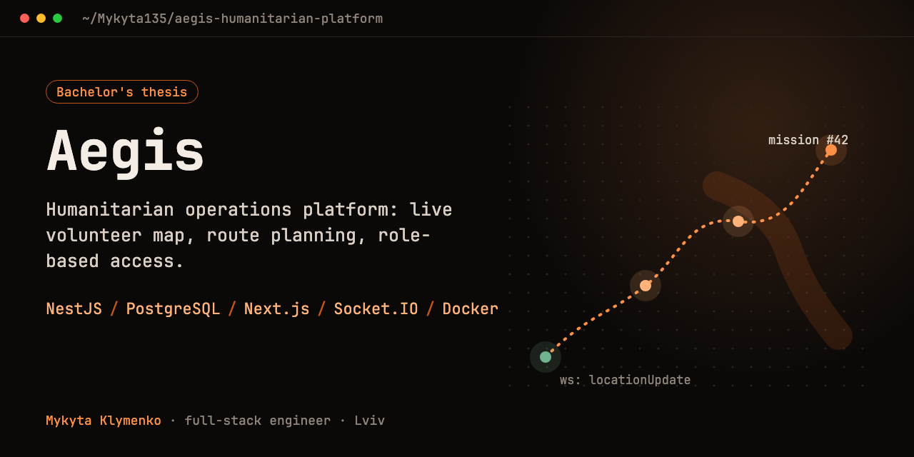
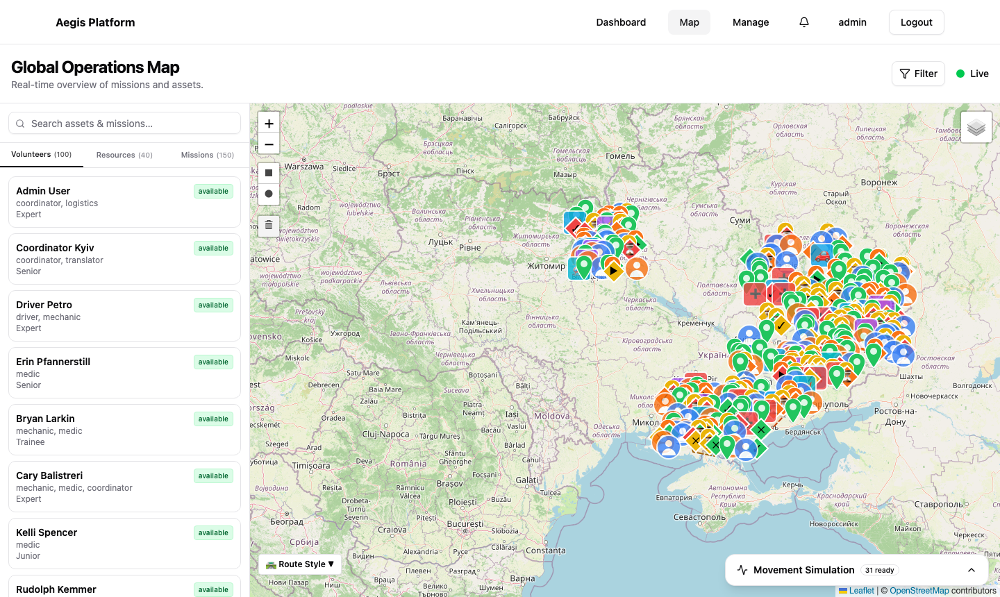
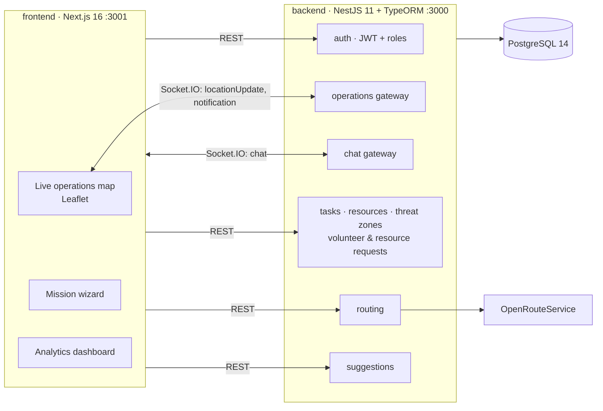
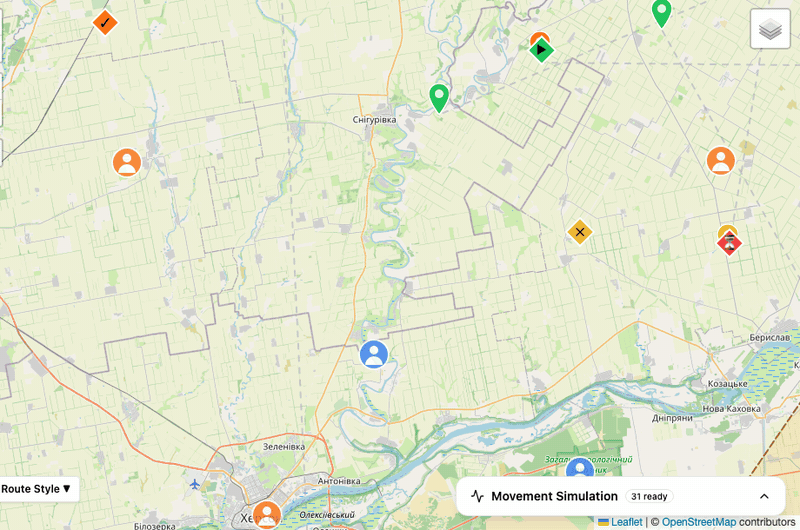

# Aegis Humanitarian Platform

[](https://github.com/Mykyta135/aegis-humanitarian-platform/actions/workflows/ci.yml)

A full-stack web application for coordinating humanitarian aid missions — managing volunteers, resources, and field operations in real time. My Bachelor's thesis at Lviv Polytechnic.

> **About the git history.** I built Aegis in May–June 2026 as my Bachelor's thesis. The code was imported here in a single commit (22 May 2026) from my university GitHub account (POlter2005), so the history starts at that import. The commits from November 2026 are later work: security hardening, CI, docs and the map fallback.



---

## Architecture



| Layer | Technology | Port |
|-------|-----------|------|
| Frontend | Next.js 16 (App Router) | 3001 |
| Backend | NestJS 11 + TypeORM | 3000 |
| Database | PostgreSQL 14 | 5432 |

All three services are containerised and orchestrated with Docker Compose. CI builds and tests the backend and builds the frontend (with its typecheck) on every push.

---

## Features

- **Mission management** — create, assign, and track field tasks with priority, difficulty, region, and status
- **Volunteer management** — profile management, skill/experience tracking, availability status
- **Resource management** — vehicles, generators, drones, medical kits with condition and status tracking
- **Live operations map** — real-time volunteer location updates over WebSockets (Socket.IO), threat zone overlays, route planning via OpenRouteService
- **Mission wizard** — step-by-step mission creation with geocoding, map-based destination picking, and rule-based volunteer suggestions (scored by skills and region)
- **Analytics dashboard** — mission statistics, volunteer performance, resource utilisation charts
- **Notifications** — real-time in-app notification centre
- **Authentication** — JWT-based auth with role-based access (admin / volunteer): only admins create, edit or delete volunteers and change roles; volunteers can read only their own profile and history; the signing key comes from the environment and the app refuses to start without one



<sub>Movement simulation, recorded in real time: the server streams the volunteer's position over Socket.IO (<code>locationUpdate</code>) and fires a completion event when the mission ends.</sub>

---

## Quick Start

### Prerequisites

- Docker and Docker Compose
- Node.js 20+ (for local development only)

### Run with Docker

Put two values in a `.env` file next to `docker-compose.yml` (it is git-ignored):

```bash
JWT_SECRET=$(openssl rand -hex 32)
OPENROUTESERVICE_API_KEY=<your key from openrouteservice.org>
```

```bash
docker compose up --build
```

| Service | URL |
|---------|-----|
| Frontend | http://localhost:3001 |
| Backend API | http://localhost:3000 |
| Swagger docs | http://localhost:3000/api |

### Seed the database

After the backend is running, trigger the seed endpoint once to populate demo data (100 volunteers, 40 resources, 150 missions). The endpoint exists only when `ENABLE_SEED=true` (set in `docker-compose.yml` for local demos) and never with `NODE_ENV=production`, because it creates accounts with known passwords:

```bash
curl -X POST http://localhost:3000/seed
```

Demo accounts created by the seed:

| Email | Password | Role |
|-------|----------|------|
| admin@aegis.local | password123 | Admin |
| coordinator@aegis.local | password123 | Admin |
| medic@aegis.local | password123 | Volunteer |
| driver@aegis.local | password123 | Volunteer |
| trainee@aegis.local | password123 | Volunteer |
| engineer@aegis.local | password123 | Volunteer |

---

## Project Structure

```
.
├── docker-compose.yml
├── dyploma-backend/        # NestJS API
│   └── src/modules/
│       ├── auth/           # JWT authentication
│       ├── users/          # Volunteer profiles
│       ├── tasks/          # Mission management
│       ├── resources/      # Resource inventory
│       ├── routing/        # OpenRouteService integration
│       ├── suggestions/    # Rule-based volunteer suggestions
│       ├── threat-zones/   # Danger zone overlays
│       ├── operations/     # Live operations & WebSocket gateway
│       ├── analytics/      # Dashboard statistics
│       └── seed/           # Manual database seeder
└── frontend/               # Next.js app
    └── app/
        ├── (dashboard)/    # Protected dashboard routes
        │   ├── page.tsx    # Main dashboard
        │   ├── map/        # Live operations map
        │   ├── tasks/      # Mission list & detail
        │   ├── volunteers/ # Volunteer directory
        │   ├── manage/     # Admin management panel
        │   └── analytics/  # Charts & statistics
        ├── login/
        └── register/
```

---

## Local Development (without Docker)

### Backend

```bash
cd dyploma-backend
npm install
# copy and edit environment variables
cp .env.example .env
npm run start:dev
```

The schema is managed by TypeORM migrations in `dyploma-backend/src/database/migrations` (no `synchronize`); pending migrations run when the API starts. After changing an entity:

```bash
npm run migration:generate -- src/database/migrations/<Name>   # writes a new migration
npm run migration:run                                          # applies it
npm run migration:check                                        # fails if entities and migrations disagree (also in CI)
```

### Frontend

```bash
cd frontend
npm install
NEXT_PUBLIC_API_URL=http://localhost:3000 npm run dev
```

---

## Environment Variables

### Backend (`dyploma-backend/.env`)

| Variable | Description |
|----------|-------------|
| `DB_HOST` | PostgreSQL host |
| `DB_PORT` | PostgreSQL port (default: 5432) |
| `DB_USERNAME` | Database user |
| `DB_PASSWORD` | Database password |
| `DB_DATABASE` | Database name |
| `JWT_SECRET` | Required. JWT signing key, at least 32 random characters (`openssl rand -hex 32`) |
| `ENABLE_SEED` | `true` only for local demos: enables `POST /seed` |
| `FRONTEND_URL` | Frontend origin for CORS |
| `OPENROUTESERVICE_API_KEY` | API key for route calculation |

### Frontend

| Variable | Description |
|----------|-------------|
| `NEXT_PUBLIC_API_URL` | Backend base URL |
| `NEXT_PUBLIC_MAPTILER_API_KEY` | Optional. MapTiler key for the satellite, terrain and dark layers; without it the map uses OpenStreetMap tiles |
